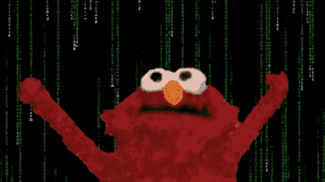

<div align="center">


<a href="https://git.io/typing-svg"></a>



<br/>

<a href="https://www.linkedin.com/in/eyad-hassan-a31b4a237/"></a>
<a href="https://twitter.com/EyadHassan999"></a>
<a href="https://www.instagram.com/eyadtamer999/"></a>
<a href="https://github.com/EyadTamer999?tab=repositories&sort=stargazers"></a>


</div>

---

### `$ whoami`

```yaml
name:      Eyad Tamer
school:    German International University (Cairo)
role:      Full-stack developer & indie game dev
currently: shipping web apps, hacking on Linux tooling, making games in Godot
os:        Fedora 🐧  # and yes, I will tell you about it
motto:     "There is no spoon."
```

### 🛠️ Stack

<p align="center">
  
  <br/>
  
</p>

### 🚀 Featured projects

| Project | What it does |
| --- | --- |
| 🎮 [**Cyber-Glory**](https://github.com/EyadTamer999/Cyber-Glory) | Endless 2D survivor game built in Godot |
| 📱 [**iphone-mirror**](https://github.com/EyadTamer999/iphone-mirror) | See and control your iPhone from Linux — USB mirror + touch, AirPlay HD |
| 🐧 [**fedora-setup**](https://github.com/EyadTamer999/fedora-setup) | My synced Fedora/GNOME setup across PC + laptop (chezmoi, auto-synced) |
| 🦆 [**what-the-duck-godot**](https://github.com/EyadTamer999/what-the-duck-godot) | Godot port of What The Duck |
| 🦀 [**The-Boys-Chat-App**](https://github.com/EyadTamer999/The-Boys-Chat-App) | Chat app written in Rust |

### 📈 Activity

<p align="center">
  
</p>

<p align="center">
  <picture>
    <source media="(prefers-color-scheme: dark)" srcset="https://raw.githubusercontent.com/EyadTamer999/EyadTamer999/output/github-contribution-grid-snake-dark.svg"/>
    <source media="(prefers-color-scheme: light)" srcset="https://raw.githubusercontent.com/EyadTamer999/EyadTamer999/output/github-contribution-grid-snake.svg"/>
    
  </picture>
</p>


<!---
EyadTamer999/EyadTamer999 is a ✨ special ✨ repository because its `README.md` (this file) appears on your GitHub profile.
--->
